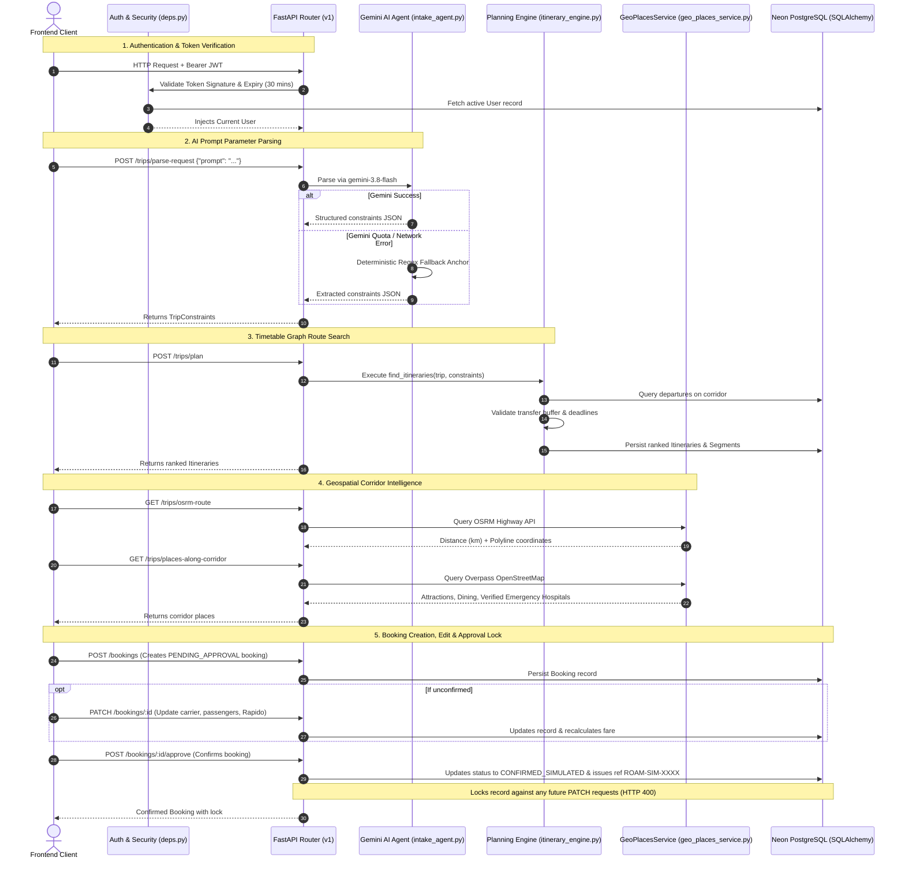
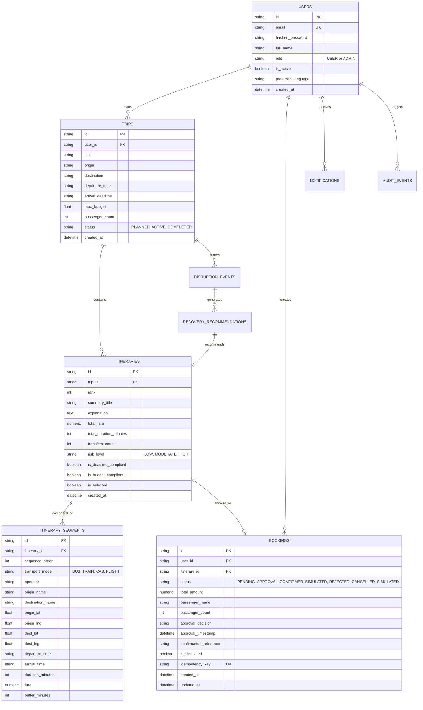

# TBS RoamAgent — Backend Architecture & Technical Design

> **Scope:** Backend Architecture, Data Modeling, Service Flow & Technology Stack  
> **Directory:** `c:\samartha hac\backend\docs\ARCHITECTURE.md`  
> **Framework:** FastAPI (Python 3.13) + Neon Cloud PostgreSQL  

---

## 1. Backend Philosophy & Architectural Principles

The RoamAgent backend is constructed around four operational tenets:
1. **Separation of LLM & Timetable Truth:** Google Gemini AI is utilized strictly as a natural language semantic parser. It is **never** permitted to hallucinate transit schedules, seat availability, or fares. Timetable data is strictly resolved deterministically via the database.
2. **Deterministic Route Graph Engine:** Direct and multi-leg transfers are calculated using graph search algorithms with hard mathematical validation on transfer buffers ($\ge 30\text{ mins}$) and arrival deadlines.
3. **External Spatial & Geocoding Decoupling:** Road corridors and regional amenities are fetched through asynchronous HTTP clients directly from OSRM (`router.project-osrm.org`) and Overpass OpenStreetMap API, with verified fallback caches for network resiliency.
4. **Human-in-the-Loop Governance:** Financial and booking actions default to `PENDING_APPROVAL`. No automated action confirms a booking without explicit traveler consent, and confirmed bookings are permanently locked from modifications.

---

## 2. Backend Technology Stack & Frameworks

| Component | Technology | Version | Role & Architecture Responsibility |
| :--- | :--- | :--- | :--- |
| **Language Runtime** | Python | `3.13.9` | Asynchronous modern Python execution |
| **Web Framework** | FastAPI | `0.115+` | High-throughput asynchronous REST API framework with Pydantic V2 validation |
| **ASGI Web Server** | Uvicorn | `0.34+` | Production ASGI web server running on `127.0.0.1:8000` |
| **Database & Pooling** | Neon PostgreSQL | Cloud `v16+` | Serverless cloud PostgreSQL over SSL (`ep-polished-term-b4fvyodq`) |
| **ORM & Data Layer** | SQLAlchemy | `2.0+` | Declarative relational object mapping with pre-ping connection recovery |
| **AI LLM Engine** | Google Gemini | `gemini-3.8-flash` | Prompt parameter extraction via the official `google-genai` SDK |
| **Security & Auth** | PyJWT & Passlib | `2.10+` | Bearer token authentication, bcrypt password hashing, 30-min token expiration |
| **HTTP Client** | HTTPX | `0.28+` | Non-blocking asynchronous network calls for OSRM, Overpass, and Nominatim |
| **Test Suite** | Pytest | `8.4+` | Automated testing framework with `pytest-asyncio` |

---

## 3. Directory & Module Structure

```
backend/
├── app/
│   ├── main.py                     # App factory, CORS, exception handlers, DB auto-seed
│   ├── core/
│   │   ├── config.py               # Pydantic BaseSettings, JWT secret, 30-minute expiration
│   │   ├── security.py             # bcrypt hashing, JWT token creation and decoding
│   │   └── deps.py                 # Dependency injectors (get_db, get_current_user)
│   ├── agent/
│   │   └── intake_agent.py         # Google Gemini AI agent (gemini-3.8-flash) & regex fallback
│   ├── db/
│   │   ├── session.py              # SQLAlchemy engine & session maker with SSL
│   │   └── seed.py                 # Timetable seeding for South Indian transit corridors
│   ├── models/
│   │   └── models.py               # Declarative ORM models (User, Trip, Booking, etc.)
│   ├── schemas/
│   │   └── schemas.py              # Pydantic validation models
│   ├── services/
│   │   ├── itinerary_engine.py     # Deterministic graph route planning engine
│   │   ├── disruption_engine.py    # Autonomous delay evaluation & recovery generator
│   │   └── geo_places_service.py   # OSRM router & Overpass API places client
│   └── api/
│       └── v1/
│           ├── router.py           # Unified v1 router
│           └── endpoints/
│               ├── auth.py         # Registration, login, profile
│               ├── trips.py        # Planning, itineraries, OSRM routes, places
│               ├── bookings.py     # Booking creation, updates, approval lock, deletion
│               ├── disruptions.py  # Disruption simulation & recovery
│               ├── notifications.py# Activity notifications
│               └── demo.py         # Reset database to seed state
├── docs/                           # Backend Documentation
│   ├── ARCHITECTURE.md             # This document
│   ├── API_REFERENCE.md            # Complete REST API reference
│   └── BACKEND.md                  # Developer & setup guide
└── tests/
    └── test_backend.py             # 8 integration test cases
```

---

## 4. Backend Service Flow



---

## 5. Entity-Relationship Data Model



---

## 6. Security & Session Integrity

1. **Session Expiry:** Access tokens have an expiration window of **30 minutes** (`ACCESS_TOKEN_EXPIRE_MINUTES = 30`).
2. **Database SSL:** Neon PostgreSQL connection enforces SSL mode (`sslmode=require`).
3. **Idempotency Protection:** Booking requests require unique `idempotency_key` strings to protect against duplicate submissions.
4. **Post-Booking Lock:** Bookings with status `CONFIRMED_SIMULATED` are permanently locked; `PATCH /api/v1/bookings/:id` returns `HTTP 400 Bad Request`.
