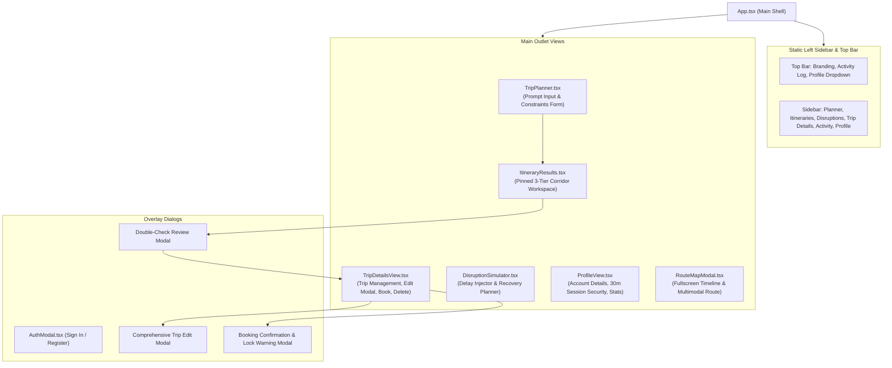

# TBS RoamAgent — Frontend Architecture & Technical Design

> **Scope:** Frontend Component Architecture, Layout Systems, State Flow & Technology Stack  
> **Directory:** `c:\samartha hac\frontend\docs\ARCHITECTURE.md`  
> **Framework:** React 19 + TypeScript + Vite + Tailwind CSS v4  

---

## 1. Architectural Principles & UI Philosophy

1. **Restrained Editorial Aesthetic:** High-contrast monochromatic palette (`#F4F4F4`, `#121C1A`, `#2D4645`, `#A3ACA9`). Zero gradients, zero neon colors, zero glassmorphism.
2. **Pinned 3-Tier Viewport Layout:** In the Itinerary workspace, the top header overview and bottom action bar remain static/pinned while the middle content scrolls smoothly without dead gutters.
3. **Double-Check Confirmation Safety:** Before committing any trip, users review a comprehensive summary of vehicle, carrier, doorstep rides, sightseeing, and dining.
4. **Persistent Session Integrity:** JWT tokens are recovered seamlessly from `sessionStorage` on page reloads, preventing abrupt logouts during the 30-minute session lifetime.

---

## 2. Frontend Technology Stack & Frameworks

| Tool / Library | Version | Purpose in Application |
| :--- | :--- | :--- |
| **React** | `19.0.0` | Declarative UI rendering using modern React hooks |
| **TypeScript** | `5.6+` | Strict type definitions across all entities and API payloads |
| **Vite** | `8.3.4` | Ultra-fast HMR and optimized production asset compilation |
| **Tailwind CSS** | `v4.0` | Utility-first styling with high-contrast editorial theme |
| **React Leaflet & Leaflet** | `1.9.4` | OpenStreetMap tile rendering, highway polylines, and Rapido pins |
| **Lucide React** | `0.475+` | Monochromatic vector icons |
| **Browser Storage** | SessionStorage | Token persistence (`roamagent_session_token`) across page refreshes |

---

## 3. Component Hierarchy & Navigation Flow



---

## 4. Pinned 3-Tier Layout Architecture

Implemented in `frontend/src/components/itineraries/ItineraryResults.tsx`:

```
+-----------------------------------------------------------------------------------------+
| TIER 1: PINNED TOP OVERVIEW & TABS BAR (flex-shrink-0)                                  |
| - Header: Trip: Chennai (CMBT Bus Terminus) ———> Hyderabad (MGBS Bus Station)           |
| - Options count badge, OSRM road distance badge                                         |
| - Single-row tab bar: [Transports] [Route] [Rapido] [Attractions] [Dining] [Hospitals]  |
+-----------------------------------------------------------------------------------------+
| TIER 2: SCROLLABLE MIDDLE CONTENT (flex-1 overflow-y-auto)                              |
|                                                                                         |
| - Available Transports list with "Select This Transport" buttons                       |
| - OR Interactive Highway Map (OSRM route polyline)                                      |
| - OR Rapido Doorstep Pickup & Drop map with address input                               |
| - OR Tourist Attractions multi-selection checkbox grid                                 |
| - OR Dining & Restaurants multi-selection checkbox grid                                 |
| - OR Verified 24/7 Emergency Hospitals grid (no bus stations)                           |
|                                                                                         |
+-----------------------------------------------------------------------------------------+
| TIER 3: PINNED BOTTOM SUMMARY & ACTION BAR (flex-shrink-0)                              |
| - Selected Transport • Rapido Surcharge • Add-on Counts • Estimated Total               |
| - [Confirm Details] Primary Action Button                                               |
+-----------------------------------------------------------------------------------------+
```

---

## 5. State Management & Flow

1. **Authentication State (`AuthContext.tsx`):**
   - Stores `user: User | null` and `token: string | null`.
   - On initial mount, reads `sessionStorage.getItem('roamagent_session_token')`.
   - Calls `api.getMe()` to authenticate. If valid, populates user without redirecting.
2. **Trip & Itinerary State (`App.tsx`):**
   - `trips: Trip[]`: Stores user trips.
   - `currentTripId: string | null`: Selected trip context.
   - `itineraries: Itinerary[]`: Ranked departures computed by backend.
   - `bookings: Booking[]`: Saved trips and confirmed bookings.
3. **Itinerary Customization State (`ItineraryResults.tsx`):**
   - `selectedItinId: string`: Picked carrier option.
   - `rapidoPickup: boolean`, `rapidoDrop: boolean`: Doorstep toggles.
   - `selectedAttractions: string[]`: Selected sightseeing spots.
   - `selectedRestaurants: string[]`: Selected dining spots.
   - `passengerCount: number`, `passengerName: string`: Passenger data.
